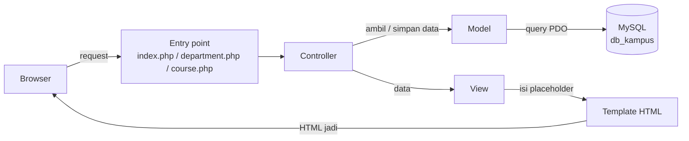
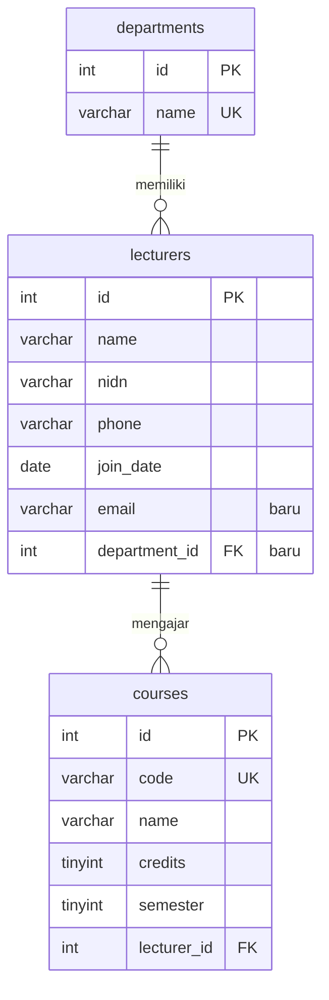
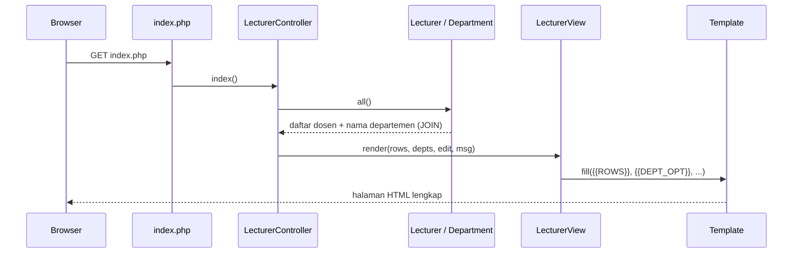
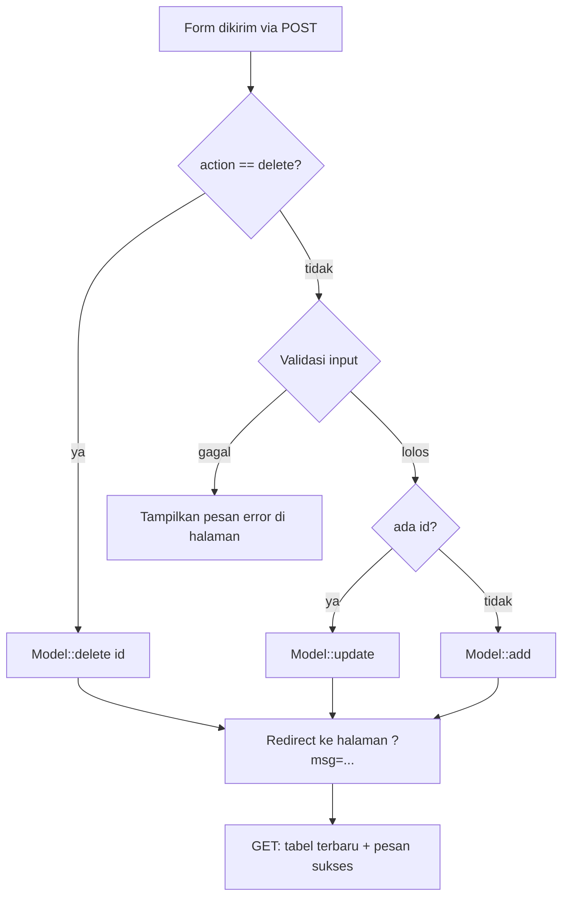

# TP8DPBO2526C1

Saya Zaidaan Dhyaa Ulhaq Budiono dengan NIM 2500945 mengerjakan Tugas Praktikum 8 dalam mata kuliah Desain dan Pemrograman Berorientasi Objek untuk keberkahanNya maka saya tidak melakukan kecurangan seperti yang telah dispesifikasikan. Aamiin

# Sistem Data Kampus (Dosen, Departemen, Mata Kuliah)

Aplikasi CRUD PHP dengan arsitektur **MVC berbasis template** (HTML dipisah dari PHP).
Mengelola tiga tabel berelasi: `departments`, `lecturers`, dan `courses`.

---

## 1. Janji

Saya Zaidaan Dhyaa Ulhaq Budiono dengan NIM 2500945 mengerjakan Tugas Praktikum 8 dalam mata kuliah Desain dan Pemrograman Berorientasi Objek untuk keberkahanNya maka saya tidak melakukan kecurangan seperti yang telah dispesifikasikan. Aamiin

### Daftar adegan yang direkam (urut)

| No | Adegan | Yang ditunjukkan | Durasi |
|----|--------|------------------|--------|
| 1 | Struktur project | Folder `controllers/`, `models/`, `views/`, `templates/` di VS Code | ±30 dtk |
| 2 | Database | Import `db_kampus.sql`, tampilkan 3 tabel + relasi (phpMyAdmin → Designer) | ±30 dtk |
| 3 | CRUD Departemen | Tambah, ubah, hapus di `department.php` | ±45 dtk |
| 4 | CRUD Dosen | Tambah dosen (pilih departemen, isi email), ubah, hapus di `index.php` | ±60 dtk |
| 5 | CRUD Mata Kuliah | Tambah mata kuliah (pilih dosen), ubah, hapus di `course.php` | ±60 dtk |
| 6 | Relasi data | Hapus departemen → dosen tetap ada (departemen jadi kosong); hapus dosen → mata kuliahnya ikut terhapus | ±45 dtk |
| 7 | Alur kode | Telusuri satu request: `index.php` → Controller → Model → View → Template | ±60 dtk |

Tips rekam: Windows `Win + G` (Xbox Game Bar) atau OBS; resolusi 1080p, aktifkan suara/narasi.

---

## 2. Desain Program

### 2.1 Arsitektur MVC



| Lapisan | File | Tugas |
|---------|------|-------|
| **Entry point** | `index.php`, `department.php`, `course.php` | Memuat `config.php`, membuat controller, memanggil `index()` |
| **Config** | `config.php` | Konstanta koneksi DB, autoload class, helper `e()` dan `nv()` |
| **Controller** | `controllers/*Controller.php` | Membaca input (`$_GET`, `$_POST`), validasi, memanggil model, memilih view |
| **Model** | `models/*.php`, `models/DB.php` | Query SQL (prepared statement PDO) |
| **View** | `views/*View.php`, `views/Template.php` | Menyusun baris tabel / opsi dropdown, mengisi template |
| **Template** | `templates/*.html` | HTML murni dengan placeholder `{{KEY}}` |

### 2.2 Struktur Folder

```
sistem_data_kampus/
├── index.php             → halaman Dosen (default)
├── department.php        → halaman Departemen
├── course.php            → halaman Mata Kuliah
├── config.php            → koneksi + autoload + helper
├── db_kampus.sql         → skema + data contoh
├── assets/               → bootstrap.min.css, bootstrap.bundle.min.js
├── controllers/          → LecturerController, DepartmentController, CourseController
├── models/               → DB, Lecturer, Department, Course
├── views/                → Template, LecturerView, DepartmentView, CourseView
└── templates/            → layout.html, lecturer.html, department.html, course.html
```

### 2.3 Desain Database (ERD)



| Relasi | Kardinalitas | Aturan hapus |
|--------|--------------|--------------|
| `departments` → `lecturers` | 1 : N | `ON DELETE SET NULL` (dosen tetap ada) |
| `lecturers` → `courses` | 1 : N | `ON DELETE CASCADE` (mata kuliah ikut terhapus) |

Perubahan dari soal: `departments` dan `courses` adalah **tabel baru**; `lecturers` adalah **tabel lama** yang ditambah atribut `email` dan `department_id`.

---

## 3. Alur Program

### 3.1 Menampilkan data (GET)



### 3.2 Menyimpan / mengubah / menghapus (POST → Redirect → GET)



Redirect setelah POST (pola *Post/Redirect/Get*) mencegah data tersimpan dua kali saat halaman di-refresh.

### 3.3 Mode edit

Klik **Edit** → `?edit=ID` → controller memanggil `Model::find(ID)` → view mengisi form dengan data lama, tombol berubah menjadi **Update** dan muncul tombol **Batal**.

### 3.4 Cara kerja Template

`templates/lecturer.html` berisi penanda seperti `{{NAME}}` dan `{{ROWS}}`.
`Template::fill([...])` mengganti semua penanda sekaligus (satu kali `strtr`), lalu `Template::page()` membungkusnya dengan `layout.html` (navbar + Bootstrap).

---

## 4. Dokumentasi Fitur

### 4.1 Halaman

| URL | Halaman | Fitur |
|-----|---------|-------|
| `index.php` | Dosen | Tambah, ubah, hapus dosen; dropdown departemen; kolom email |
| `department.php` | Departemen | Tambah, ubah, hapus departemen |
| `course.php` | Mata Kuliah | Tambah, ubah, hapus; dropdown dosen pengampu; SKS & semester |

### 4.2 Parameter & aksi

| Aksi | Cara | Method |
|------|------|--------|
| Lihat daftar | buka halaman | GET |
| Mulai edit | `?edit=ID` | GET |
| Simpan baru | form, `id` kosong | POST |
| Update | form, `id` terisi | POST |
| Hapus | tombol Hapus (`action=delete`, `id`) | POST |

### 4.3 Validasi

| Halaman | Aturan |
|---------|--------|
| Departemen | Nama wajib; nama harus unik |
| Dosen | Nama wajib; email, NIDN, HP, tanggal, departemen opsional |
| Mata Kuliah | Kode, nama, dan dosen wajib; kode harus unik |

### 4.4 Keamanan

- **SQL Injection:** semua query memakai prepared statement PDO.
- **XSS:** semua output melewati `e()` (`htmlspecialchars`).
- **Injeksi placeholder:** `Template::fill()` mengganti dalam satu pass.
- **Hapus aman:** memakai POST + konfirmasi, bukan link GET.

---

## 5. Dokumentasi

| Halaman | Gambar |
|---------|--------|
| Dosen | `docs/dosen.png` |
| Departemen | `docs/departemen.png` |
| Mata Kuliah | `docs/matakuliah.png` |
| ERD (phpMyAdmin Designer) | `docs/erd.png` |

Tampilkan dengan ``.
